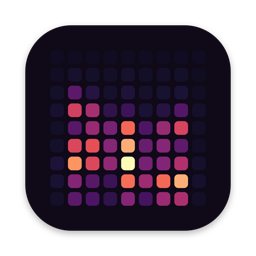

<p align="center"></p>

<h1 align="center">Mel</h1>

<p align="center">Records your meetings and transcribes them on your Mac. Nothing leaves it.</p>

- Hears both sides of any call (Zoom, Meet, Teams, Slack…) without extra audio drivers.
- Live transcript, speakers told apart and recognized by voice, and a title for every meeting.
- Any language Whisper knows, even switching mid-meeting.

## Install

Needs an Apple Silicon Mac with macOS 15 or later.

```sh
git clone https://github.com/diegoquezadac/mel.git
cd mel
./mel setup
```

The setup walks you through everything, from developer tools to models (~4 GB) and permissions.

## Use

Open **Mel** and click **+**. Or record from the terminal with `./mel start`.

## Learn more

[How Mel works](docs/README.md): architecture, diagrams and every moving part.

Using a coding agent like Claude Code? Ask it to set up Mel: [AGENTS.md](AGENTS.md) tells it how.

## License

[MIT](LICENSE)
