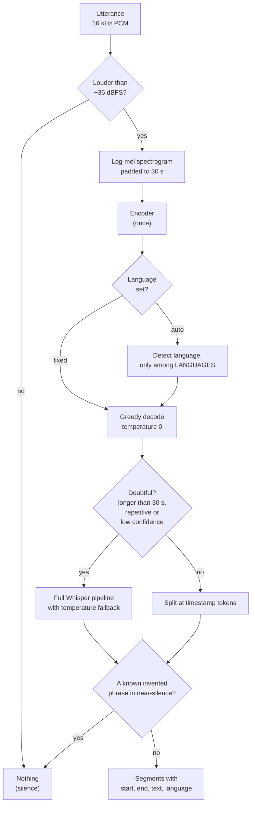

# 3. Transcription

The server (`server/app.py`) runs **Whisper large-v3-turbo** with [mlx-whisper](https://github.com/ml-explore/mlx-examples/tree/main/whisper), Apple's MLX port, on the GPU. An utterance of a few seconds takes about one second.

## One utterance, step by step

- **Encode once.** The encoder is the expensive half of Whisper. Its output is reused for language detection and decoding, instead of running it twice like `mlx_whisper.transcribe` would.
- **Language per utterance.** Detection is limited to the languages in your meetings (Settings › Languages, `en,es` by default), so a short Spanish sentence isn't mistaken for Portuguese. Since every utterance is detected separately, a meeting can switch languages at any point.
- **Fast path, safe fallback.** Most utterances need a single greedy decode. When Whisper's own signals look bad (compression ratio above 2.4 means it's repeating itself; average log-probability below −1 means it's unsure), the utterance goes through the full pipeline, which retries at higher temperatures.
- **Timestamps.** Whisper emits timestamp tokens every 20 ms; segments are split at them, then offset by the utterance's position in the meeting.

## Text that nobody said

Whisper learned from hundreds of thousands of hours of subtitled video. In those videos, silence is often captioned "Thank you.", "Gracias." or "Subscribe to the channel!". So given near-silence (breathing, typing, a quiet room), Whisper writes one of those.

In real meetings recorded with Mel, these phrases peaked around **−34 dBFS**, while real speech rarely went below **−23 dBFS**. Two filters use that gap:

| Filter | Rule |
| --- | --- |
| Silence | Utterances whose loudest 20 ms are below −36 dBFS aren't transcribed. The quietest 1% of real speech measured was −32 dBFS. |
| Known phrases | If the whole result is one of the typical invented phrases (`GHOSTS` in `server/app.py`) and the audio peaked below −26 dBFS, it's dropped. Said out loud, "gracias" stays. |

Dropped phrases are logged (`./mel logs`).

## One GPU thread

MLX binds its GPU streams to the thread that created them, so every MLX call (Whisper and the title model) runs on one dedicated thread. FastAPI handles requests asynchronously and hands the work to that thread. pyannote uses PyTorch on Metal and runs on its own thread, so speaker detection and titling can run at the same time.

## Models

| Model | Size | Notes |
| --- | --- | --- |
| `whisper-large-v3-turbo` | 1.6 GB | Default. Nearly as accurate as large-v3, several times faster. |
| `whisper-large-v3-mlx` | 3.1 GB | Most accurate, about 2× slower. |
| `whisper-small-mlx` | 0.5 GB | Fastest, for older Macs or when transcription falls behind. |

Pick one in the app's **Settings › Models**, or see [Configuration](configuration.md).

---

[← 2. Recording](02-recording.md) · [4. After the meeting →](04-after-the-meeting.md)
