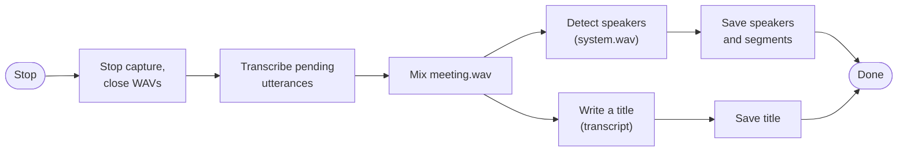

# After the meeting

Pressing Stop (or Ctrl+C) doesn't end the work: the last utterances are still being transcribed, the other people haven't been told apart, and the meeting has no name. The client finishes all of it before exiting.

## Stopping safely

The app stops a recording with `SIGTERM`; the terminal with Ctrl+C (`SIGINT`). The first one stops the capture. After that, **a second one can only skip the step that's running**: pending transcription, speaker detection or the title. Saving the meeting always finishes. In the app, a double click on Stop does nothing; the explicit **Skip** button skips a step.

## Telling speakers apart

During the meeting, everyone on the call is "Them": they all come through the same system audio. Afterwards, [pyannote](https://github.com/pyannote/pyannote-audio)'s `speaker-diarization-community-1` pipeline runs over `system.wav` on the GPU (about 10× faster than real time) and returns:

- **Turns**: who spoke when. Mel uses the *exclusive* version, without overlapping speech, which lines up better with transcript segments.
- **A voiceprint per speaker**: a 256-number embedding of their voice.

Each "Them" line takes the speaker of the turn it overlaps most. Speakers whose voiceprint matches a [voice you've named](voices.md) get that name; the rest are numbered "Speaker 1", "Speaker 2"… in order of appearance. Each speaker is saved with its voiceprint (`speakers.voiceprint`), so you can name them later and Mel can learn from it.

Speaker detection is optional: it needs a free Hugging Face account to download the model ([setup](setup.md)). Without it, the transcript keeps "Me" and "Them".

## Naming the meeting

A small local language model, **Qwen3 4B Instruct** (4-bit, ~2.3 GB, via [mlx-lm](https://github.com/ml-explore/mlx-lm)), reads the transcript and writes a title like a calendar event: "Q3 budget review", "Onboarding de nuevos ingenieros". The prompt (`TITLE_PROMPT` in `server/app.py`) asks for 2 to 6 words about the subject, in the meeting's language, and always some title, even a guess. Long meetings are shortened to their first 22,000 and last 8,000 characters, which is plenty for a title and much faster.

The title is saved in `meetings.title`. Meetings you titled yourself (`./mel start "Standup"`, or renamed in the app) keep their title.

Titling uses only the text, so it runs at the same time as speaker detection. Both models are loaded when the server starts, so a meeting is usually finished seconds after you stop it.

## Doing it again

`./mel transcribe <meeting>` (or **⋯ › Transcribe Again** in the app) repeats everything from the saved WAVs: cut, transcribe, detect speakers, title. The new speakers and segments replace the old ones in one transaction, so the previous transcript stays intact until the new one is complete. Useful after changing the model or the language, or if the server was down during the meeting.
