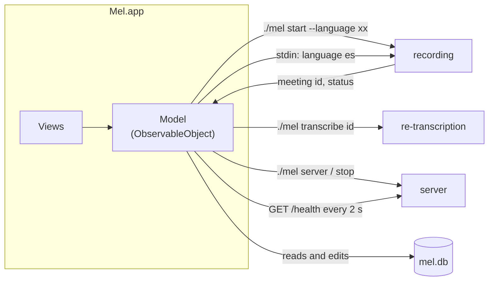

# The app

`Mel.app` is a SwiftUI app (`app/Sources`) in three files: `App.swift` holds the state and talks to `./mel`, `Database.swift` to `mel.db`, `Views.swift` is the interface. It follows the standard macOS layout: a sidebar of meetings grouped by day, a detail page, a toolbar and a Settings window.

## A thin layer over `./mel`

The app doesn't record or transcribe by itself. It runs the same commands you'd type:

- **Recording** runs `./mel start`. The first output line says which meeting it is (`● Recording → meeting 12`), and the transcript comes from that meeting's segments as the client inserts them: once a second, the app checks `PRAGMA data_version` and re-reads only when another process committed. Changing the language writes `language es` to the recording's stdin.
- **Stopping** sends `SIGTERM` once. **Skip** sends another, which skips the current step ([after the meeting](after-the-meeting.md)).
- **The server** starts when the app opens and stops when you quit, unless a recording started from the terminal is still using it.
- **Editing** is SQL on `mel.db` ([data](data.md)): renaming a meeting updates its title; naming a speaker links them to a person and [learns the voice](voices.md); Move to Trash moves the audio folder to the Trash and deletes the meeting's rows. Settings are rows of `settings`.
- **The database** is opened through `app/Sources/Database.swift`, a small wrapper over SQLite's C API, after `./mel init` has created or migrated it.

## Pages

| Page | What's on it |
| --- | --- |
| Meeting | Editable title, date, speaker chips (click to name), transcript grouped by speaker, and a player along the bottom. Hovering a block turns its avatar into a play button. |
| Recording | The transcript as it's written, with the time, language and Stop along the bottom. |
| Floating transcript | A dark panel above every window and Space, with the transcript as chat bubbles (yours on the right), so you can follow it during a full-screen call. It's an `NSPanel` that never takes focus. |
| Settings | Recording language and microphone, models, server status and logs, voices, storage. |

## Keyboard

| Key | Action |
| --- | --- |
| ⌘R | New recording |
| Esc, ⌘. | Stop recording |
| Space | Play or pause; on the recording page, stop |
| ← → | Skip 15 seconds |
| ↑ ↓ | Previous or next meeting |
| ⌫ | Move the meeting to the Trash |
| ⇧⌘C | Copy the transcript |
| ⌥⌘R | Show in Finder |
| ⇧⌘T | Show the floating transcript |

Space and the arrows go through an `NSEvent` monitor, so they work wherever focus is, except while you're typing.

## Building

`./mel build` compiles the app with SwiftPM, wraps it into `~/Applications/Mel.app` with `app/Info.plist` and the icon, and signs it. The bundle records where the repository is (`MelRoot` in Info.plist), which is how the app finds `./mel`. See [Setup](setup.md) for why signing matters.

The icon is drawn by `app/Icon/make-icon.swift`: a mel spectrogram of three spoken syllables in matplotlib's *magma* colormap. Delete `app/Icon/AppIcon.icns` and rebuild to regenerate it.
