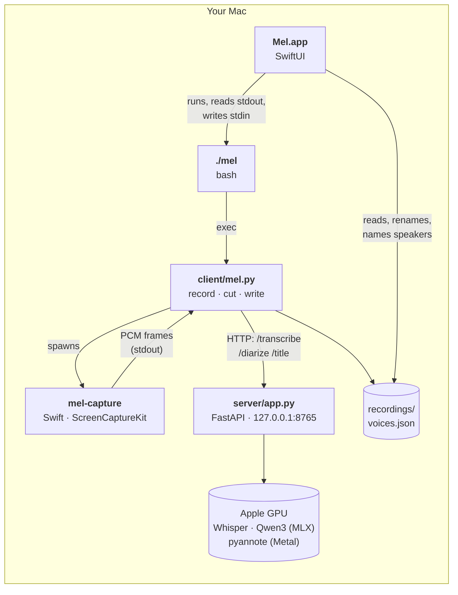
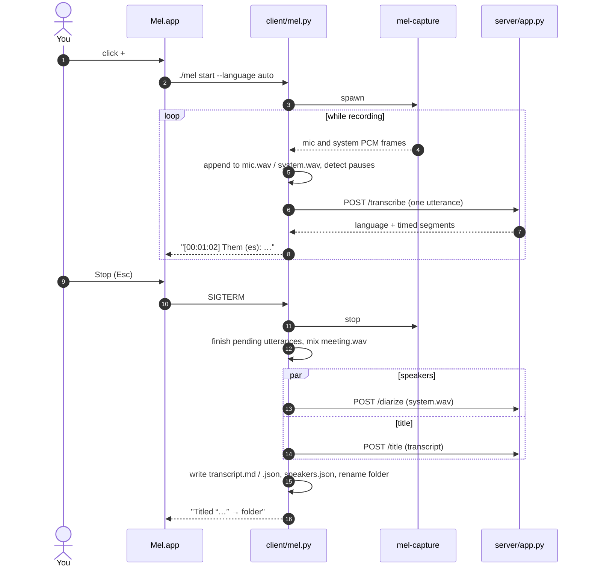

# Architecture

Mel is four small programs. Each does one thing and talks to the next over a pipe or local HTTP.

| Piece | Language | Job |
| --- | --- | --- |
| `mel-capture` | Swift | Asks ScreenCaptureKit for the microphone and everything the Mac plays, converts both to 16 kHz mono and writes them to stdout as framed PCM. |
| `client/mel.py` | Python | Saves each source to its own WAV, cuts the audio into utterances at pauses, sends them to the server, and writes the transcript. When the meeting ends: speakers, title, final files. |
| `server/app.py` | Python | Keeps the models loaded in memory and serves them over HTTP: Whisper for text, pyannote for speakers, Qwen3 for titles. |
| `Mel.app` | SwiftUI | Starts and stops the others through `./mel`, shows the live transcript, and lets you read, play, rename and organize meetings. |
| `./mel` | bash | One entry point for people and for the app: setup, building, the server's lifecycle, recording. |

## Why it's split this way

- **The server outlives recordings.** Loading Whisper, Qwen3 and pyannote takes seconds and about 5 GB of memory. One long-lived process loads them once and serves every recording, the app and the terminal alike.
- **The recorder never waits on the GPU.** Audio is written to disk as it arrives and transcription happens on a background queue. If transcription falls behind or the server is down, nothing is lost; `./mel transcribe` catches up later.
- **The app is a thin layer.** Everything it does, the terminal can do too (`./mel start`, `./mel transcribe`), and both produce the same files. The app adds the window, playback and editing.
- **Every Python script carries its own dependencies** ([PEP 723](https://peps.python.org/pep-0723/) headers), and `uv run` creates its environment on first use. No virtualenv to manage.

## A meeting, end to end

## What ends up on disk

Each meeting is a folder in `recordings/`, named `<date>_<time>_<Title>`:

| File | Contents |
| --- | --- |
| `mic.wav` | Your microphone, 16 kHz mono, written live |
| `system.wav` | Everything the Mac played (the call), on the same timeline |
| `meeting.wav` | Both mixed, for playback |
| `transcript.md` | `[hh:mm:ss] **Speaker**: text`, readable anywhere |
| `transcript.json` | The same with start, end and language for every segment |
| `speakers.json` | One voiceprint per speaker, used to [recognize voices](voices.md) |

Outside the meetings: `voices.json` holds the voices you've named, `server/config.env` the languages and models, `models/` the downloaded models.

## Privacy

Audio, transcripts and voiceprints stay on your Mac. The only network traffic is downloading models from Hugging Face during setup (or the first time you pick a new model in Settings). The server listens on `127.0.0.1` only.
