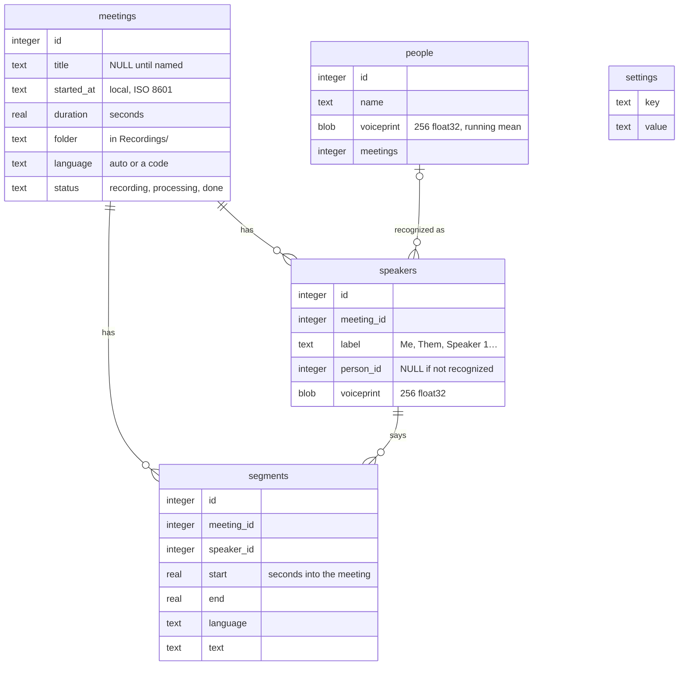

# Data

Everything Mel knows lives in one SQLite database, `mel.db`: meetings, transcripts, speakers, the people you've named and your settings. Audio stays in WAV files next to it, one folder per meeting.

```
~/Library/Application Support/Mel/
  mel.db                              the database (plus mel.db-wal and mel.db-shm while in use)
  Recordings/2026-10-27_10-38-05/     one folder per meeting, named by its start time, never renamed
    mic.wav  system.wav  meeting.wav
```

Set `MEL_DATA` to use another folder. `./mel build` records the location in the app.

SQLite is what Apple's own apps use (Notes, Photos, Messages, Voice Memos). Mel talks to it with plain SQL, from Python (`sqlite3`) and from Swift (the SQLite C API that ships with macOS), with no ORM.

## Tables



| Table | One row is |
| --- | --- |
| `meetings` | A recording. Its title is a column, so renaming a meeting never moves files. |
| `speakers` | A voice in one meeting: "Me" (your microphone), "Them" (the call, before speaker detection) or "Speaker N". |
| `segments` | A line of the transcript, as Whisper returns it: usually a sentence. The transcript is a meeting's segments ordered by `start`. |
| `people` | Someone you've named, with the voiceprint Mel recognizes them by. |
| `settings` | Languages, models, recording language, microphone, floating transcript. |
| `segments_search` | A full-text index over `segments.text`, kept up to date by triggers. It ignores accents: "reunion" finds "reunión". |

**A speaker's name is `COALESCE(people.name, speakers.label)`.** Naming a speaker links them to a person instead of rewriting text, so renaming a person updates every meeting they're in. See [Voices](voices.md).

The schema lives in `db/001_initial.sql`, with comments on every column.

## Who writes what

| | |
| --- | --- |
| `./mel` | Creates the database and applies migrations. Reads the settings the server needs (`LANGUAGES`, `MODEL`, `LLM`) and passes them as environment variables. |
| `client/mel.py` | During a recording, inserts the meeting and each segment as it's transcribed (that's how the app shows the live transcript). At the end, replaces the meeting's speakers and segments with the final ones in one transaction, and sets the title and status. |
| `Mel.app` | Reads everything; edits titles, speaker names, people and settings; deletes meetings. |
| `server/app.py` | Never touches the database: it only turns audio into text, speakers and titles. |

The database runs in WAL mode, so the app reads while a recording writes, and it notices other processes' commits through `PRAGMA data_version`. Foreign keys cascade, so deleting a meeting deletes its speakers and segments.

## Migrations

Schema changes are numbered files in `db/` (`001_initial.sql`, `002_…`). Every `./mel` command checks `PRAGMA user_version` and applies the newer files in order, each in one transaction. To change the schema, add the next file; never edit one that has shipped.

## Querying

`./mel sql` opens the database in the `sqlite3` shell, or runs a query:

```sh
./mel sql "SELECT id, title, started_at FROM meetings ORDER BY started_at DESC LIMIT 5"
./mel export 12        # a meeting as Markdown
```

Every meeting with Ana:

```sql
SELECT DISTINCT m.id, m.title, m.started_at
FROM meetings m
JOIN speakers s ON s.meeting_id = m.id
JOIN people p ON p.id = s.person_id
WHERE p.name = 'Ana'
ORDER BY m.started_at DESC;
```

Search every transcript:

```sql
SELECT m.title, s.start, s.text
FROM segments_search
JOIN segments s ON s.id = segments_search.rowid
JOIN meetings m ON m.id = s.meeting_id
WHERE segments_search MATCH 'presupuesto'
ORDER BY rank;
```

Time spent in meetings this week:

```sql
SELECT round(sum(duration) / 3600, 1) AS hours
FROM meetings
WHERE started_at >= date('now', 'weekday 1', '-7 days');
```

## Backups and privacy

To back up Mel, copy `~/Library/Application Support/Mel/` while Mel isn't recording, or use `sqlite3 mel.db ".backup copy.db"` for the database alone. Time Machine includes the folder.

The database and recordings hold real conversations and stay on your Mac. They're outside the repository, so they never end up in git.

## Coming from an older version

Before the database, meetings were folders in the repository's `recordings/` with `transcript.json`, `speakers.json` and `transcript.md`, plus `voices.json` and `server/config.env`. `./mel import` moves all of it into the database:

- the audio is moved into `Recordings/`
- the old text files are backed up to `backup-<date>.tar.gz`, then left in `recordings.imported/`
