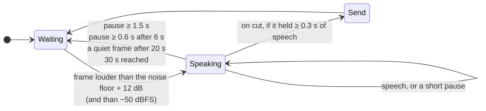

# Recording

## Capturing both sides of a call

Apps like Zoom or Meet play the other people's voices through the Mac's audio output. Since macOS 15, **ScreenCaptureKit** can capture that output and the microphone in the same stream, without a virtual audio driver like BlackHole. `mel-capture` (`capture/Sources/main.swift`) does just that:

- One `SCStream` with `capturesAudio` (everything the Mac plays, except the recorder's own process) and `captureMicrophone`. ScreenCaptureKit needs a display and a video output even when you only want audio, so it captures a 2×2 pixel frame once per second and throws it away.
- Audio arrives as 48 kHz stereo float and is converted to **16 kHz mono 16-bit**, which is what Whisper expects.
- Each buffer goes to stdout with a small header, so the client can tell the sources apart and line them up in time:

```
┌──────────┬───────────────────┬─────────────────┬──────────────────────────┐
│ source   │ presentation time │ frame count     │ PCM samples              │
│ uint8    │ float64 seconds   │ uint32          │ int16 × frame count      │
│ 0 mic    │                   │                 │                          │
│ 1 system │                   │                 │                          │
└──────────┴───────────────────┴─────────────────┴──────────────────────────┘
          little endian, struct "<BdI" in client/mel.py
```

## Two tracks on one timeline

`client/mel.py` reads the frames and appends each source to its own WAV. The first frame's timestamp is time zero. When a source goes quiet (nobody is playing audio, for example), ScreenCaptureKit sends nothing at all, so the client fills gaps longer than 100 ms with silence. That keeps `mic.wav` and `system.wav` aligned, and every transcript timestamp points to the same moment in both.

The microphone is **you** ("Me"); the system audio is **everyone else** ("Them", later split into speakers). That's why headphones matter: without them your microphone also hears the call, and the other people show up twice.

## Cutting audio into utterances

Whisper reads up to 30 seconds at a time, and the transcript should appear while people talk, so each track is cut into utterances at pauses. The `Segmenter` is a simple energy-based endpointer:



- Audio is analyzed in 30 ms frames.
- The **noise floor** follows the room: quickly while it's quiet, slowly while someone speaks, so a constant hum is eventually ignored.
- 300 ms before the first loud frame are kept, so the first syllable isn't clipped.
- Long monologues are cut at the first short pause after 6 seconds, so the live transcript keeps up.

Each utterance goes to a background queue that posts it to the server. The audio thread never waits for transcription. If the queue grows past six utterances, the client warns that the model can't keep up (a smaller model helps).

## Live language changes

The recording language can change while recording. The app writes `language es` (or `auto`) to the client's stdin, and every utterance from then on uses it. You can type the same thing in a terminal recording.

## Next

[Transcription](transcription.md) explains what the server does with each utterance; [After the meeting](after-the-meeting.md) covers what happens when you press Stop.
