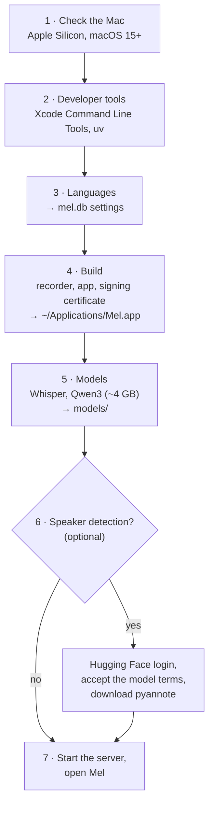

# Setup and permissions

## What `./mel setup` does

The wizard (`scripts/setup.sh`) checks before doing anything, so running it again is safe: finished steps are skipped. It's also how you change languages or add speaker detection later.



Command output goes to `setup.log`; on failure the wizard shows the end of it.

## Why the app has its own certificate

macOS asks for permission before an app records the screen or microphone, and it remembers the answer by the app's **code signature**. An unsigned or ad-hoc signed app gets a new signature on every build, so macOS treats each build as a new app: permissions look granted in System Settings but no longer apply.

Setup creates a self-signed certificate, `Mel local signing`, in your login keychain, and every build is signed with it. The app's identity becomes "bundle `local.mel` signed by this certificate", which stays the same across builds, so you grant permissions once.

The certificate only signs Mel on your Mac. It isn't trusted by anyone else and can't be used to distribute the app.

## Permissions

| Permission | Why |
| --- | --- |
| Microphone | Your voice |
| Screen & System Audio Recording | The call. ScreenCaptureKit captures system audio under this permission; Mel only takes audio and a 2×2 pixel frame it discards. |

macOS grants them to the **app that starts the recording**: Mel when you click +, or your terminal app for `./mel start`. The first recording asks for both; after allowing, macOS asks you to quit and reopen.

## Speaker detection and Hugging Face

pyannote's speaker model is free but gated: Hugging Face asks you to accept its terms, and downloads need a token.

1. A token with the **Read** role from <https://huggingface.co/settings/tokens>.
2. `hf auth login` (the wizard runs it) stores it in `~/.cache/huggingface`. Mel never stores it.
3. Accept the terms at <https://huggingface.co/pyannote/speaker-diarization-community-1>.

After the download, speaker detection runs offline.

## Uninstalling

```sh
./mel stop
rm -rf ~/Applications/Mel.app
security delete-certificate -c "Mel local signing"
tccutil reset All local.mel
```

Then delete the repository folder (models) and `~/Library/Application Support/Mel` (your meetings).
