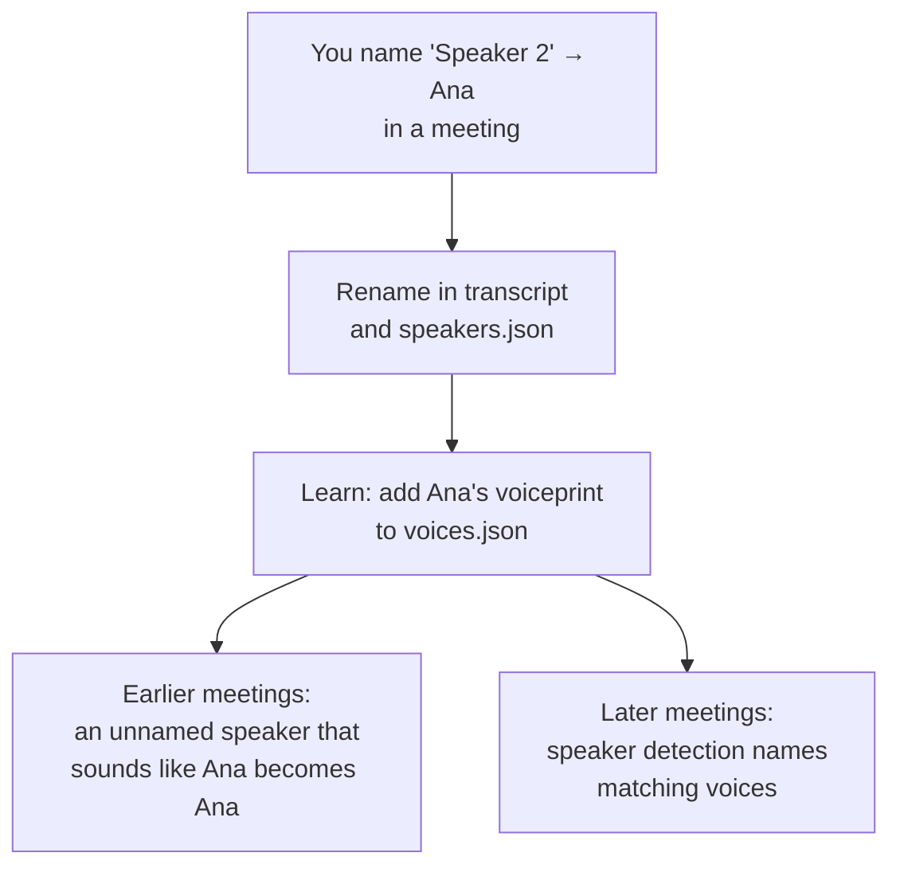

# Voices

Name a speaker once, and Mel recognizes them in every meeting, before and after.



## Voiceprints

Speaker detection gives every speaker in a meeting a voiceprint: a 256-number vector from pyannote's speaker-embedding model. Two recordings of the same person point in nearly the same direction; different people don't. Mel compares voices by **cosine similarity**:

| | Typical similarity |
| --- | --- |
| Same person, different meetings | ~0.9 |
| Different people | 0.3 to 0.7 |
| Mel's threshold (`VOICE_MATCH`) | **0.75** |

## Learning

`voices.json` keeps one vector per name and how many meetings it came from:

```json
{ "Ana": { "embedding": [0.012, -0.044, …], "meetings": 3 } }
```

Each time you name someone, their voiceprint is averaged into their vector, weighted by meeting count. Different microphones, rooms and connections all feed one profile, so recognition improves the more you name.

## Recognizing

- **New meetings.** After speaker detection, each speaker's voiceprint is compared to every named voice. The best pairs are matched first, each name is used once per meeting, and only pairs above the threshold count. The rest stay "Speaker N".
- **Earlier meetings.** When you name someone, and every time the app opens, Mel looks for that voice in your other meetings. A speaker still called "Speaker N" whose voiceprint matches gets the name, without transcribing again. It never renames someone who already has a name.

Only other people are recognized: your microphone is always "Me".

## Managing voices

**Settings › Voices** lists everyone Mel knows and lets you forget a voice. Voiceprints never leave your Mac.
